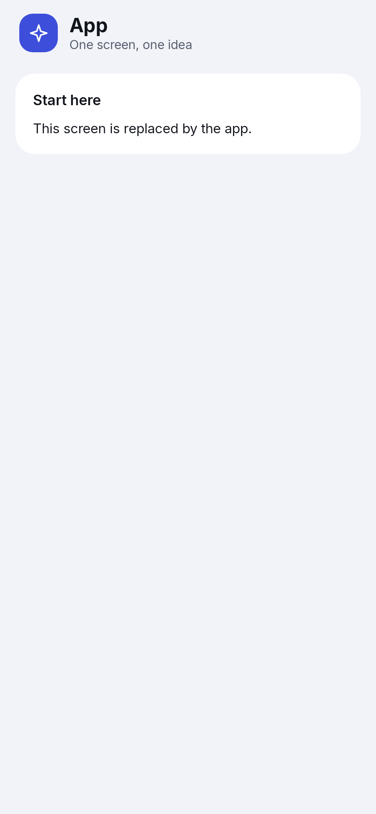
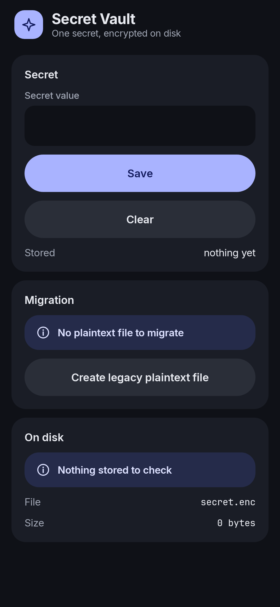
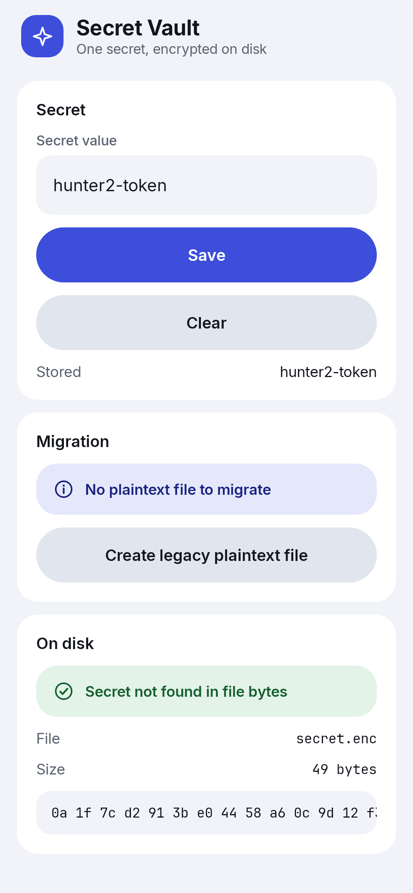
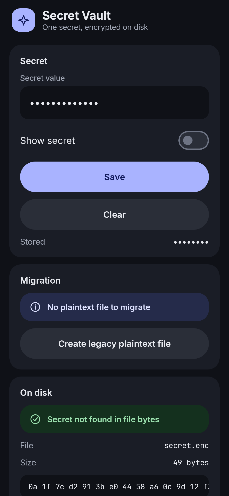
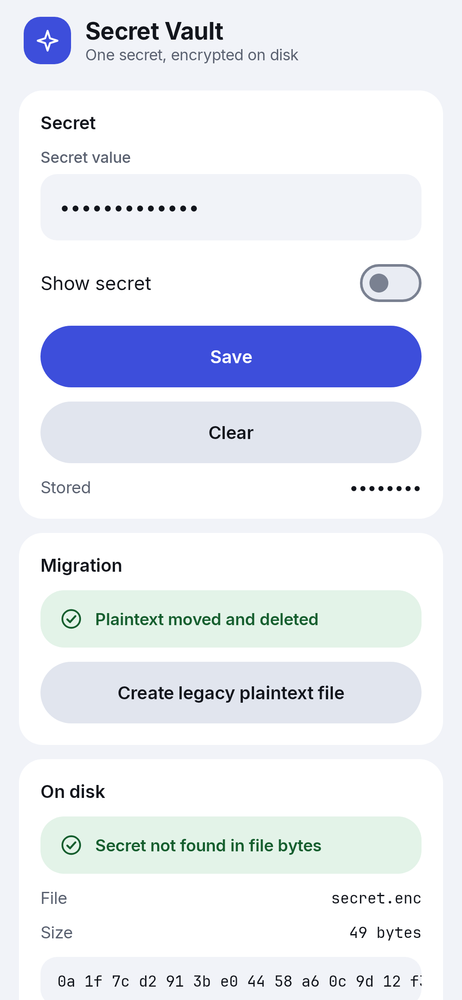
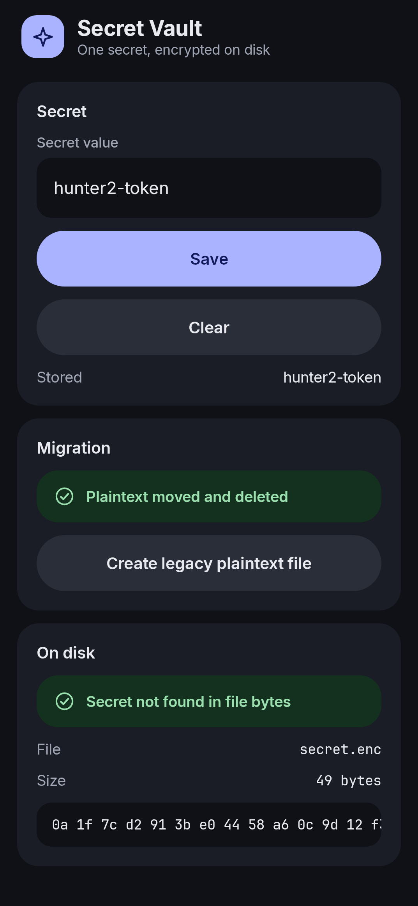
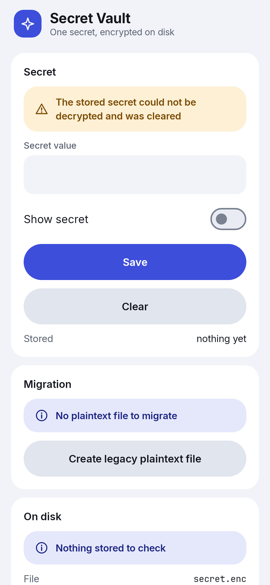
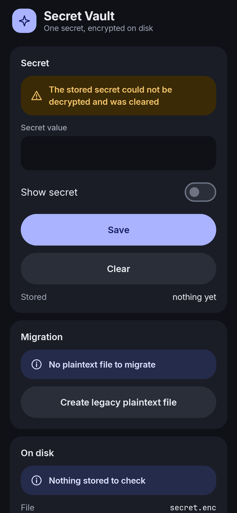

# Secret Vault

Keeps one secret string in a Jetpack DataStore encrypted with Tink and an Android Keystore key.

[](https://github.com/cixweb/secret-vault/actions/workflows/ci.yml)  [](LICENSE)

Secret Vault stores a single secret string in a DataStore file. The file is encrypted with an AEAD from a Tink keyset that is protected by an Android Keystore master key, and the vault is opened off the main thread. A one-time migration moves a legacy plaintext value into the encrypted file and deletes the old file. A file that no longer decrypts is reset instead of crashing the app, and the vault files stay out of backups. A Compose screen reads and writes the secret, hidden by default, and reports the migration outcome and whether the file on disk contains the secret in clear text. JVM tests use a real in-memory Tink AES256_GCM keyset.

<table>
<tr>
<td align="center"><b>Main screen</b><br> </td>
<td align="center"><b>Encrypted on disk</b><br> </td>
</tr>
<tr>
<td align="center"><b>Migration done</b><br> </td>
<td align="center"><b>Reset after a lost key</b><br> </td>
</tr>
</table>

## Why it matters

A plain DataStore file is just the serialized value. Anyone who can read the app's files, for example from a backup, a rooted device or a debugging session, sees the secret as it is. Android's file-based storage encryption protects the device at rest, but not the file once the app's data is exposed.

Encrypting by hand is easy to get wrong: keys end up stored next to the data, and a ciphertext can be copied to another file and still decrypt. Existing users also already have a plaintext file, so switching the store without a migration either loses their value or leaves the old file lying around.

## How it works

The encrypted store wraps the plain serializer in AeadSerializer. Every write is encrypted by the Aead and every read decrypts it. The associated data is the file name, so a ciphertext only decrypts under the name it was written for. Any decryption failure, wrong key or wrong associated data, surfaces as CorruptionException, which DataStore already knows how to handle.

The Aead comes from an AeadProvider interface. On the device, the implementation uses AndroidKeysetManager with a Keystore master key, so the keyset itself is stored encrypted. In tests an in-memory provider builds a real AES256_GCM keyset, so the tests exercise real encryption instead of a fake.

```kotlin
/**
 * Encrypts what [SecretSerializer] writes. The file name is the associated data, so a file
 * copied or renamed to another name no longer decrypts; failures surface as CorruptionException.
 */
fun encryptedSecretSerializer(aead: Aead, fileName: String): Serializer<String> =
    AeadSerializer(
        aead = aead,
        wrappedSerializer = SecretSerializer,
        associatedData = fileName.toByteArray(Charsets.UTF_8),
    )
```

From [`EncryptedSecretSerializer.kt`](app/src/main/java/io/github/cixweb/secretvault/data/EncryptedSecretSerializer.kt#L7-L16), lines 7-16.

## Code map

Sources are under `app/src/main/java/io/github/cixweb/secretvault/`; `test/` is the same package under `app/src/test/`.

```text
crypto/  Source of the Aead.
data/    Stores, serializers, migration and corruption reset.
ui/      Screen and state.
test/    JVM tests with real Tink encryption.
```

### `crypto/`

- **[`AeadProvider.kt`](app/src/main/java/io/github/cixweb/secretvault/crypto/AeadProvider.kt)**: Interface that hands out an Aead.
- **[`KeystoreAeadProvider.kt`](app/src/main/java/io/github/cixweb/secretvault/crypto/KeystoreAeadProvider.kt)**: Builds the Aead from an AndroidKeysetManager keyset protected by a Keystore master key.

### `data/`

- **[`SecretSerializer.kt`](app/src/main/java/io/github/cixweb/secretvault/data/SecretSerializer.kt)**: Plain serializer of the secret string.
- **[`EncryptedSecretSerializer.kt`](app/src/main/java/io/github/cixweb/secretvault/data/EncryptedSecretSerializer.kt)**: Wraps the plain serializer in AeadSerializer with the file name as associated data.
- **[`SecretStore.kt`](app/src/main/java/io/github/cixweb/secretvault/data/SecretStore.kt)**: DataStore wrapper with plaintext and encrypted factories.
- **[`PlaintextMigration.kt`](app/src/main/java/io/github/cixweb/secretvault/data/PlaintextMigration.kt)**: DataMigration moving the legacy value and deleting the plaintext file.
- **[`CorruptionReset.kt`](app/src/main/java/io/github/cixweb/secretvault/data/CorruptionReset.kt)**: Replaces a file that does not decrypt with an empty secret and records it.
- **[`SecretVault.kt`](app/src/main/java/io/github/cixweb/secretvault/data/SecretVault.kt)**: Opens files, AEAD, migration, corruption reset and store off the main thread.
- **[`FileInspector.kt`](app/src/main/java/io/github/cixweb/secretvault/data/FileInspector.kt)**: Reads the file bytes to report whether they contain the secret.

### `ui/`

- **[`MainScreen.kt`](app/src/main/java/io/github/cixweb/secretvault/ui/MainScreen.kt)**: Compose screen for the secret (hidden by default), migration status and file check.
- **[`SecretViewModel.kt`](app/src/main/java/io/github/cixweb/secretvault/ui/SecretViewModel.kt)**: Opens the vault once, holds UI state and turns failures into an error state.

### `test/`

- **[`InMemoryAeadProvider.kt`](app/src/test/java/io/github/cixweb/secretvault/crypto/InMemoryAeadProvider.kt)**: Test provider with a real in-memory AES256_GCM keyset.
- **[`AeadProviderTest.kt`](app/src/test/java/io/github/cixweb/secretvault/crypto/AeadProviderTest.kt)**: Encrypts and decrypts bytes with the test provider.
- **[`EncryptedSecretSerializerTest.kt`](app/src/test/java/io/github/cixweb/secretvault/data/EncryptedSecretSerializerTest.kt)**: Round trip and CorruptionException for wrong associated data or key.
- **[`PlaintextMigrationTest.kt`](app/src/test/java/io/github/cixweb/secretvault/data/PlaintextMigrationTest.kt)**: Migration with data, without data, and a second run.
- **[`SecretStoreTest.kt`](app/src/test/java/io/github/cixweb/secretvault/data/SecretStoreTest.kt)**: Store read/write and check that the encrypted file does not contain the secret.
- **[`SecretVaultTest.kt`](app/src/test/java/io/github/cixweb/secretvault/data/SecretVaultTest.kt)**: The Aead is built on the IO dispatcher; a bad file or a lost key resets the secret.
- **[`BackupRulesTest.kt`](app/src/test/java/io/github/cixweb/secretvault/BackupRulesTest.kt)**: Every backup rule excludes the vault files and the keyset preferences.

## Try it

Requirements: JDK 17 and the Android SDK.

```bash
git clone https://github.com/cixweb/secret-vault.git
cd secret-vault
./gradlew installDebug
```

Once it is running:

- Launch the app, enter a secret and save it; turn on Show secret to see it.
- Restart the app to see the value read back from the encrypted file.
- Tap Create legacy plaintext file, then restart the app to watch the migration.

## Verification

Unit tests and screenshot tests, the same checks CI runs on every push:

```bash
./gradlew testDebugUnitTest
./gradlew validateDebugScreenshotTest
```

## Dependencies

Kotlin, Jetpack Compose and Material 3. Versions, all pinned in `gradle/libs.versions.toml`: `gradle` 9.8.2, `agp` 9.4.1, `kotlin` 2.4.21, `compose-bom` 2026.09.00, `activity-compose` 1.13.0, `lifecycle` 2.11.0, `core-ktx` 1.19.1, `junit` 4.13.2, `screenshot` 0.0.1-alpha16, `datastore` 1.3.0, `datastore-tink` 1.3.0.

## Caveats

- The Keystore-backed provider is not exercised by the JVM tests, only the in-memory one.
- Only one string is stored.
- The file check inspects raw bytes for the secret; it does not prove cryptographic strength.
- There is no key rotation, and a reset loses the old secret by design.
- The migration outcome is kept in memory, so after a restart the screen shows that there is nothing left to migrate.

## License

MIT, see [LICENSE](LICENSE).
